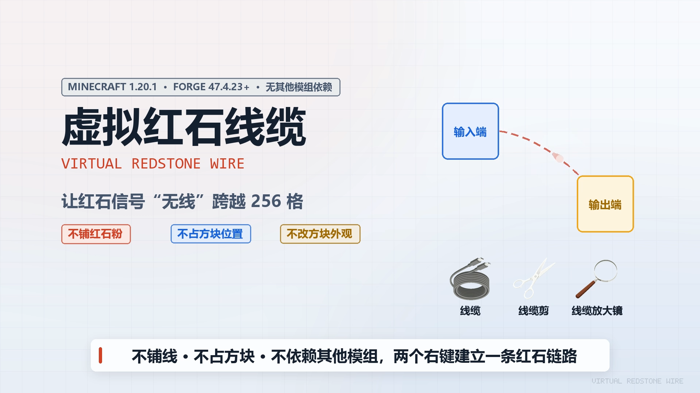

# Virtual Redstone Wire (虚拟红石线缆)

[简体中文]
| [[English]](./README_en-US.md)

为红石信号远程传递实现的Minecraft模组，不依赖实体红石方块，支持一对一、一对多、多对一连接。

---

](./intro/intro_video.gif)

# 模组使用

## 前置要求

| 项 | 要求 |
|:---:|:---:|
| Minecraft | 1.20.x |
| 模组加载器 | Forge |

> Minecraft游戏版本与Forge版本对照表见[支持的版本](#支持的版本)

## 模组物品

### 线缆

- 物品ID: `virtual_redstone_wire:virtual_cable`
- 合成: 1红石 + 1铁锭
- 使用: 
  - 手持物品右键选中输入端方块后,再次右键选中输出端方块以创建单向红石链路
  - 手持物品右键选中输入端方块后,再次右键取消选中
  - 输入端可连接多个输出端,输出端可接收多个输入端

### 线缆剪

- 物品ID: `virtual_redstone_wire:cable_cutter`
- 合成: 2木棍 + 1铁锭
- 使用: 右键输入端方块切断其全部出链

### 线缆放大镜

- 物品ID: `virtual_redstone_wire:cable_magnifier`
- 合成: 1木棍 + 1玻璃板 + 1红石
- 使用: 
  - 手持时高亮显示全部链路(输入端蓝色,输出端黄色,链路红色)
  - 手持物品右键方块查看其坐标和红石信号强度
  - 手持物品潜行右键方块打开其链路信息面板

## 撤销与重做

- 主手或副手持有任一本模组物品时，按 `Ctrl+Z` 撤销、`Ctrl+Y` 重做 (可更改按键绑定)
- 操作历史仅保存在客户端内存,退出游戏清空
- 线缆剪批量删除的链路可整体撤销或重做

## 查看操作历史

手持放大镜时按 `Ctrl+A` 打开操作历史窗口页(可更改按键绑定)

## 红石行为

- 虚拟线缆传输的是 0-15 的红石信号强度
- 输入端方块检测其所在位置的红石信号
- 输入端的红石变化会实时反映到输出端
- 支持一对多广播、多对一合并取最大值
- 链路信号单向传播
- 信号从输出方块的指定面发出,方向精确

# 模组配置

## 客户端

- 配置文件: `config/virtual_redstone_wire-client.toml`

| 配置项 | 默认值 | 取值范围 | 含义 |
|:---:|:---:|:---:|:---:|
| `enableChatFeedback` | `false` | `true` / `false` | 是否在聊天栏显示链路操作的结果反馈 |
| `undoHistorySize` | `20` | `10` - `100` | 撤销栈与重做栈各自的条数上限 |
| `undoRedoFeedback` | `true` | `true` / `false` | 是否显示撤销与重做的各类提示 |

## 服务端

- 配置文件: `<世界存档>/serverconfig/virtual_redstone_wire-server.toml`

| 配置项 | 默认值 | 取值范围 | 含义 |
|:---:|:---:|:---:|:---:|
| `maxLinkDistance` | `256` | `1` - `1024` | 单条链路允许的最大距离, 单位为方块 |
| `magnifierRenderDistance` | `512` | `64` - `1024` | 手持放大镜时链路高亮渲染的最大距离, 单位为方块 |
| `networkChangeLogSize` | `200` | `200` - `1000` | 增量同步所用的近期变更表容量 |
| `operationLogEnabled` | `true` | `true` / `false` | 是否记录每一条已生效或被拒绝的增删操作 |
| `operationLogSplit` | `total` | `total` / `both` / `player` | 操作日志的文件分割方式, 依次为合并写入, 合并与按玩家分文件同时写, 仅按玩家分文件 |
| `operationLogFile` | `Virtual_Redstone_Wire-Operations.log` | 自定义文件名 | 操作日志的文件名, 按玩家分文件时在文件名主体后追加玩家名称 |
| `requestLogEnabled` | `false` | `true` / `false` | 是否记录收到的每一条请求原文与最终结果码, 属调试级 |
| `requestLogFile` | `Virtual_Redstone_Wire-Requests.log` | 自定义文件名 | 请求日志的文件名 |

# 模组数据

## 链路数据

| 世界维度 | 数据文件 |
|:---:|:---:|
| 主世界 | `<世界存档>/data/virtual_redstone_wire_network.dat` |
| 下界 | `<世界存档>/DIM-1/data/virtual_redstone_wire_network.dat` |
| 末地 | `<世界存档>/DIM1/data/virtual_redstone_wire_network.dat` |

## 日志数据

- 操作日志: `<世界存档>/Virtual_Redstone_Wire-Operations.log` 和 `Virtual_Redstone_Wire-Operations_<玩家名称>.log`
- 请求日志: `<世界存档>/Virtual_Redstone_Wire-Requests.log`

# 支持的版本

1.20.1 为基线版本,其它兼容版本如下:

| Minecraft | Forge版本 | 模组文件名称后缀 |
|:---:|:---:|:---:|
| 1.20 | 46.x | mc-1.20_1.20.1-forge |
| 1.20.1 | 47.x | mc-1.20_1.20.1-forge |
| 1.20.2 | 48.x | mc-1.20.2-forge |
| 1.20.3 | 49.0.x | mc-1.20.3_1.20.4-forge |
| 1.20.4 | 49.2.x | mc-1.20.3_1.20.4-forge |
| 1.20.5 | 不支持 | 不支持 |
| 1.20.6 | 50.2.x | mc-1.20.6-forge |
| 1.21 | 51.0.x | mc-1.21_1.21.1-forge |
| 1.21.1 | 51.0.x | mc-1.21_1.21.1-forge |
| 1.21.2 | 不支持 | 不支持 |
| 1.21.3 | 53.1.x | mc-1.21.3-forge |
| 1.21.4 | 54.1.x | mc-1.21.4-forge |
| 1.21.5 | 55.1.x | mc-1.21.5-forge |
| 1.21.6 | 56.0.x | mc-1.21.6_1.21.7-forge |
| 1.21.7 | 56.0.x | mc-1.21.6_1.21.7-forge |
| 1.21.8 | 58.1.x | mc-1.21.8-forge |

Fabric 侧基线版本:

| Minecraft | Fabric 加载器 | 模组文件名称后缀 |
|:---:|:---:|:---:|
| 1.20.1 | 0.16.x | mc-1.20.1-fabric |

# 多语言支持

当前模组支持的语言有:
- 简体中文
- English

> 模组语言随游戏语言自动变更。

# 开发构建环境

## 基线版本

| 组件 | 要求 |
|:---:|:---:|
| Java | JDK17 |
| Gradle | 8.14.3 |
| Minecraft | 1.20.1 |
| 模组加载器 | Forge 47.4.23 |

## 兼容版本

| Minecraft | Java | Gradle | 模组加载器 |
|:---:|:---:|:---:|:---:|
| 1.20 | Java 17 | 8.14.3 | Forge 46.0.14 |
| 1.20.1 | Java 17 | 8.14.3 | Forge 47.4.23 |
| 1.20.2 | Java 17 | 8.14.3 | Forge 48.1.0 |
| 1.20.3 | Java 17 | 8.14.3 | Forge 49.0.2 |
| 1.20.4 | Java 17 | 8.14.3 | Forge 49.2.8 |
| 1.20.5 | 不支持 | 不支持 | 不支持 |
| 1.20.6 | Java 21 | 8.14.3 | Forge 50.2.0 |

## 构建脚本

| 命令 | 说明 |
|:---:|:---:|
| `python versions/build_version.py list` | 列出全部适配目标与所需环境版本 |
| `python versions/build_version.py prework mc-1.20.2-forge` | 生成该目标的工作副本 |
| `python versions/build_version.py build mc-1.20.2-forge` | 生成并构建该目标, 产物留在该目标的工作副本 |
| `python versions/build_version.py copy` | 检查各版本目录下的构建产物模组 jar, 全部复制到 release/ |
| `cd versions-fabric && gradlew.bat build` | 构建 Fabric 侧基线产物, 产物在该工程自己的 build/libs/ |

构建产物规范:
- 文件名称: `VirtualRedstoneWire-v<模组版本>-mc-<起始MC版本>_<终止MC版本>-<模组加载器名称>.jar`
- 起始版本与终止版本一致时合并为单值
- 起始版本与终止版本匿名其一时,匿名的留空,保留下划线
- 不允许起始版本与终止版本同时匿名

其他开发信息详见 [开发者文档](./docs/developer/README.md)

# 贡献指南

详见 [CONTRIBUTING.md](./CONTRIBUTING.md)

# 许可证

本项目基于 [MIT 许可证](./LICENSE) 开源。

# 版权信息

Copyright (c) 2026 JularDepick

详见 [COPYRIGHT文件](./COPYRIGHT)

# 需要协作

- 缺少优秀的物品贴图素材方案
- 缺少更多版本的支持(提案或PR)
- 缺少更多语言的支持(提案或PR)

# 相关链接

- CurseForge模组链接：https://www.curseforge.com/minecraft/mc-mods/virtual-redstone-wire
- Modrinth模组链接：https://modrinth.com/mod/virtual-redstone-wire
